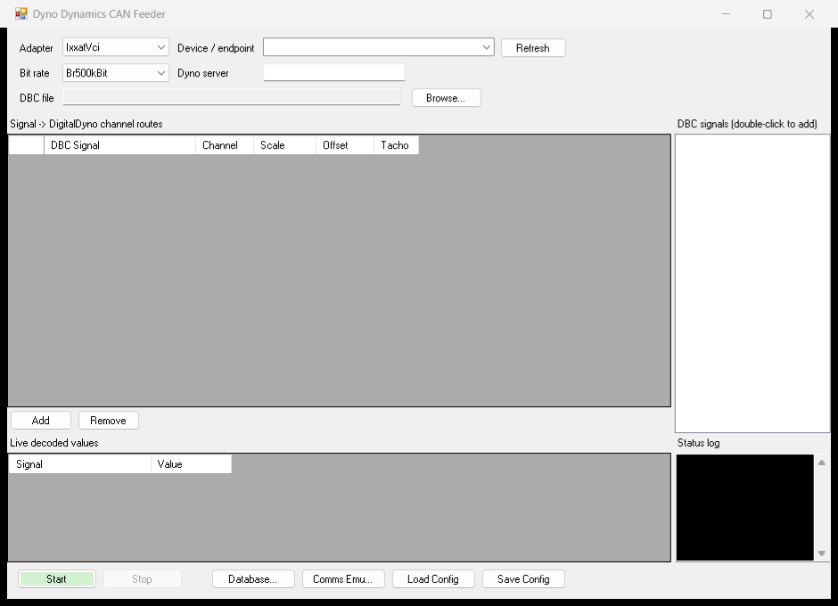

# Dyno Dynamics CAN Feeder

Bridges a live CAN bus (**IXXAT**, **OBDX**, generic **J2534**, **SavvyCAN/GVRET**, **PEAK
PCAN-USB**, or a cable-free **VirtualTcp** RawCanWire feed) into **Dyno Dynamics DigitalDyno**, decoding
user-chosen DBC signals (engine **RPM**, wideband **lambda**, anything in a DBC) and republishing
them to DynoServer as an "ECU" producer — the same role `DynoClientECU.exe` plays, but sourced
from any DBC-described device instead of a hard-coded per-brand protocol.



> **Build prerequisite:** three proprietary Dyno Dynamics assemblies
> (`DynoDotNet.dll`, `Lib_ECU.dll`, `Lib_CAN.dll`) are **not** included — copy them from a
> licensed DigitalDyno install into `libs\`. See [`libs/README.md`](libs/README.md).

## Quickstart — bench test with no cable

Drive the whole pipeline (CAN → decode → DigitalDyno) without any hardware:

1. In **UltimateCANScanner**, start its **TCP frame server** (`127.0.0.1:51729`), or run **CAN-Replay**
   against a captured log.
2. Run `DynoDynamicsCanFeeder.exe`: **Adapter → VirtualTcp**, Device `tcp:127.0.0.1:51729`, load a DBC
   and add routes (double-click a signal — scale/offset auto-fill from the DBC), then **Start**.
   Decoded values stream into **Live decoded values**, and into DigitalDyno once the ECU is registered
   (**Database…** creates it).
3. For the dyno's own devices, **Comms Emu…** emulates the Weather Station + EDM sensors (e.g. inlet
   air temp) straight into DigitalDyno — no comms hub needed.

All of that runs on one PC with DynoServer, so you can validate DBCs, routes, and gauges before you're
anywhere near the rollers.

## How it works

```
CAN bus --> IXXAT / OBDX (UltimateCANScanner adapters) --> DbcDecoder --> signal routes
        --> ECU_Packet --> ProducerConnection (DynoDotNet.dll) --> DynoServer --> DigitalDyno
```

The dyno multiplies the raw u16 we send by the channel's `Scale` (+`Offset`) from
`sys_ecuchanneldef`, so `feeder.config.json` route Scale/Offset must match the DB rows.

## Reused code (do not diverge — update from source project)

Copied from `D:\Projects\UltimateCANScanner\src`:
`Can/ICanAdapter.cs`, `Can/CanBusService.cs` (IXXAT VCI4), `Can/CanFrame.cs`, `Can/CanDeviceInfo.cs`,
`Can/Obdx/*` (OBDX DVI, USB/WiFi), `Decoding/DbcDecoder.cs`, `Decoding/DbcMessageInfo.cs`.

## Build (on the dyno PC)

Prereqs: .NET SDK (builds net48), IXXAT VCI4 driver installed (`C:\Program Files\HMS\Ixxat VCI`).

```
cd D:\Projects\Dyno\DynoDynamicsCanFeeder
dotnet build -c Release
```

### Porting notes — VERIFY on first build (net48 vs the net8 source)

These are the known deltas from the net8 UltimateCANScanner sources; fix if the compiler flags them:
- **OBDX BLE** removed. `Can/Obdx/BleObdxTransport.cs` here is a throwing net48 stub (BLE needs
  WinRT). Use OBDX over USB (`serial:`) or WiFi (`tcp:`).
- `AdapterFactory.cs` replaces UCS's `CanAdapters.cs` and adds the backends the feeder supports:
  IXXAT (`Can/CanBusService.cs`), OBDX (`Can/Obdx/*`), **J2534** (`Can/J2534/*`, net48 port using
  kernel32 `LoadLibrary` instead of `NativeLibrary`), **SavvyCAN/GVRET** (`Can/Gvret/*`, serial/TCP),
  and **PEAK PCAN-USB** (`Can/Peak/*`, via `PCANBasic.dll`). J2534 needs a 64-bit vendor driver;
  PEAK needs the PEAK-System driver; both resolve their DLLs at runtime (nothing to ship).
- Watch for net5+ only APIs in the copied files (e.g. `Enum.GetValues<T>()`), range/index on
  arrays, and `record struct` — all OK under `<LangVersion>latest`, but confirm the build is clean.
- `System.IO.Ports` / `System.Text.Json` come via NuGet (netstandard2.0 assets) for net48.

## Use (GUI)

Just run `DynoDynamicsCanFeeder.exe` — the WinForms GUI exposes every option:
- **Adapter** (IXXAT / OBDX / J2534 / GVRET / PEAK) and **Device / endpoint** (Refresh enumerates;
  for OBDX or GVRET over WiFi type
  `tcp:<ip>:<port>` directly).
- **Bit rate**, **Dyno server** (blank = auto-discover), **DBC file** (Browse).
- **Signal -> channel routes** grid (add manually, or double-click a name in the **DBC signals**
  list). Set Channel/Scale/Offset per the DB rows; tick **Tacho** for the RPM channel.
- **Live decoded values** + **Status log** show what's flowing once you press **Start**.
- **Load/Save Config** read and write the same `feeder*.config.json` files.

Headless (unattended): `DynoDynamicsCanFeeder.exe --headless feeder.aem.config.json`.

## Configure (files)

The shipped `feeder*.config.json` presets (Haltech / AEM / ECOtrons / GM RPM / OBDX-WiFi) can be
loaded from the GUI or edited by hand: adapter, bitrate, DBC path, and signal->channel routes.

## Register the ECU in DigitalDyno

Preferred — **in-app editor** (no SQL): click **Database...** in the main window (or run
`DynoDynamicsCanFeeder.exe --dbeditor`). It:
- Auto-locates `Documents\<ver>\databases\dyno-e.db` (or Browse), lists existing ECUs.
- **New ECU** pre-fills "CAN DBC Feeder" with a free Protocol ID (>= 20).
- **Import from feeder routes** fills the channel table from your routes (channel #, scale,
  offset, guessed unit) and sets the Tacho channel.
- **Save to database** backs up dyno-e.db, then inserts/updates the ECU and replaces its channels
  in one transaction. Close DigitalDyno first; restart it to see the new ECU, then select it.

Fallback — `feeder-ecu.sql` (edit `UnitID`s to real `sys_unit` ids, then
`sqlite3 dyno-e.db < feeder-ecu.sql`). Units: rpm=161, Lambda=280, AFR=290.

## Comms-hub emulator (experimental)

**Comms Emu...** in the main window (or `DynoDynamicsCanFeeder.exe --comms`) emulates DigitalDyno's
non-ECU devices without the hardware: it registers with DynoServer and, on a timer, announces the
ticked devices present (COMMS Interface / Weather Station / Pit Box / EDM ...) via `DEVICE_STATUS`
and publishes editable data points via `DATA_VALUE` — the same DynoCAN transport as the ECU feeder,
keyed by `eDeviceId`.

Includes **EDM sensor emulation**: the inlet air temperature is a built-in dyno channel fed by the
EDM board — confirmed from a live FTDI capture to be `DATA_VALUE` on **param 0x24 (raw/10 = degC)**,
so the default feeds it directly (no DB row). The EDM's 4 general-purpose inputs
(`0x20/0x28/0x3A/0x3B`) are emitted too. **Custom Channels...** (or `--customch`) edits
`user_customchanneldef` — create the "EDM Input 1-4" custom channels with the right `SourceId` +
unit + 2-point calibration so they display. (Weather-station params 1/2/3 work; the real hardware
uses 0x1B/0x1C/0x1D.) See the RE write-up in `reverse/` (not in this repo — it shims a proprietary
driver) and docs/GOTCHAS.md.

## Run & verify (needs hardware)

1. Start DynoServer + DigitalDyno; select the feeder ECU.
2. `DynoDynamicsCanFeeder.exe feeder.config.json` — console shows `[server] register: Succeeded` and
   `[can] ... on <device>`.
3. Rev the engine / apply the wideband; confirm RPM + lambda update live in DigitalDyno.
4. Cross-check raw CAN with UltimateCANScanner to confirm ids/scaling before trusting values.

## Status

**Compiles clean** (net48 x64, 0 warnings) against the real DynoDotNet.dll/Lib_ECU.dll +
Ixxat.Vci4/DbcParserLib/System.IO.Ports. The net48 down-level fixes are done (PolySharp for
Index/Range/init; manual Math.Clamp/Convert.ToHexString/Dictionary.Remove/array-slice edits).

**Source DBCs authored + verified** (`tools/DbcVerify`, no hardware needed) — all in `DBC/`:
`AEM_X-Series.dbc`, `ECOtrons_ALM.dbc`, `Haltech_WB2.dbc` (use this, NOT the vendor
`Haltech_dash.dbc`, which mis-decodes under the big-endian convention). The GM `ECM_HS.dbc` is a
vendor DBC and is **not** shipped here — drop your own copy into `DBC/` to use `feeder.gm-rpm.config.json`
(DbcVerify skips its check when absent). Configs shipped: `feeder.config.json` (Haltech RPM+lambda),
`feeder.aem.config.json`, `feeder.ecotrons.config.json`, `feeder.gm-rpm.config.json`,
`feeder.aem-obdx-wifi.config.json`. Re-run `cd tools/DbcVerify && dotnet run` after editing any DBC.

**Only remaining step: hardware verification** — the dyno PC with the VCI/OBDX driver, DynoServer
running, and a live bus. One feeder instance handles one bus/DBC; run multiple instances (or merge
DBCs) to pull RPM + wideband from different buses at once.
